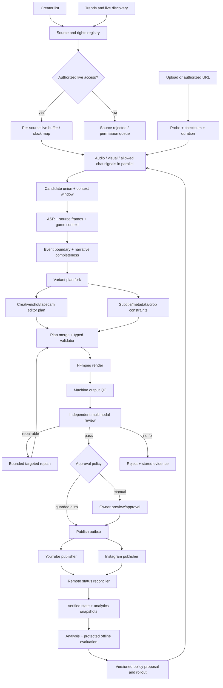

# SYSTEM DESIGN — BRANCHING, PARALLELISM, TYPED HANDOFFS AND RECOVERY
**Architectural starting hypothesis:** single API/control service + durable database + long-running per-source ingest workers + bounded media/LLM workers + platform adapters. A clean modular monolith is easier to verify on 1 VM; contracts allow scaling into multiple workers/nodes. Adopt/reuse components after a measured bake-off, not a wholesale fork without code audit.

## Multi-branch execution graph

**Graph rule:** branches can execute independently but cannot cross join unless tied to same `source_id`, `event_id`, `revision` and compatible config/rights versions. No agent should rely on opaque shared conversational memory.

## Control plane and data plane separation
**Control plane:** Authenticated FastAPI interface; source and authorization registry; settings; state machine and queue; cron/scheduler; approval queue; publisher outbox, external API quota trackers; audit and performance panels.
**Data plane:** per-source capture pipelines; media buffering; transcription jobs; deterministic candidate features; multimodal model calls; FFmpeg render; QC; storage. Heavy jobs must be process-isolated to avoid whole control-service crashes or memory spikes.

### Dedicated services/stage interfaces
- `SourceDiscoveryAdapter.find(region, platform, game, freshness)` returns ranked candidates + `method` and `source_timestamp`, never opaque 'best' claims.
- `AuthorizedSourceAdapter.open(source_credential_ref)` returns allowed streaming/recording contract or rejects with actionable permission error; Twitch native clip path is a separate adapter.
- `MediaIndex.ingest(stream_id, segment)` validates decode/probe/copy; stores monotonic timestamp map and discontinuities.
- `CandidateDetector.score(window, signals, model_version)` returns evidence and feature-level provenance; outputs multiple candidates per stream; never blocks on a single LLM answer to keep capture alive.
- `ContextBuilder.extract(event_id)` joins ASR, frame coordinates, audio peaks and rights context; source-quoted claims, unknown when not proven.
- `BoundaryPlanner.propose(event, raw_window)` may propose event onset/peak/resolution and timeline; `BoundaryValidator` checks source PTS, speech/cut integrity and platform limits separately.
- `EditPlanner.plan` includes smart crop/layout, styled captions, gaming content, safe areas, effects, hooks, versioning. Model outputs are suggestions; compiler validates and FFmpeg executes.
- `OutputQc.inspect` obtains actual rendered stream/probe/frame/audiometry; output QA cannot be skipped if one provider times out.
- `VideoJudge.review` compares source event with rendered output (audio + visual + captions), explains proposed change and rates story fidelity/crop/pacing; independent when possible, measured against editors.
- `ApprovalPolicy.decide` combines hard gates and soft scoring, with manual approval default.
- `PublishingAdapter.submit/status` implements outbox + remote reconciliation; never assume an HTTP 200 creates a visible post.
- `AnalyticsAdapter.snapshot` fetches supported metrics with exact units, timestamps and permissions; missing is null, not zero.
- `PolicyEvaluator` tests new versions on holdout/human gold set; only promotes if wins pre-registered thresholds and safety is stable.

## Time is a first-class type
All media events track three clocks: `source_ms` (relative to beginning of each source or VOD), `pts`/timebase (encoded presentation), and `received_utc` (monitor). Record timestamp drift, dropped packets, VOD offsets, segment number and discontinuity events. Prevent hard concatenation of incompatible PTS across reconnect. If a source restarts, roll a new `capture_epoch` and map offsets instead of pretending time is continuous.

## Durable state and state transitions
Example phases: `DISCOVERED` → `AUTHORIZED` → `BUFFERING/INGESTING` → `CANDIDATE` → `EVIDENCED` → `BOUNDARY_APPROVED` → `PLANNED` → `RENDERED` → `QC_MACHINE_PASS` → `QC_EDITOR_PASS` → `AWAITING_APPROVAL` → `APPROVED` → `PUBLISH_OUTBOX` → `REMOTE_PROCESSING` → `PUBLISHED_CONFIRMED` → `METRICS_READY`. Separate terminal `REJECTED`, `NEEDS_PERMISSION`, `NEEDS_HUMAN`, `INVALID_INPUT`, `DEAD_LETTER`, `CANCELLED` and corrective `RETRY_SCHEDULED` states.

State transitions are guarded by DB compare-and-set/version numbers. No model writes arbitrary stage names. Implement append-only `event_history` and `error_events`. Every transition records actor, transition reason, source revision, measured inputs, model/commit versions, source checksum and previous state; migrations should preserve old histories.

## Concurrency and fairness
- **Source concurrency:** independent buffers per live source; source acquisition never waits for rendering to complete. `15 simultaneous` means 15 live source pipelines can ingest and detect within measured quality objectives, not 15 transcodes demanded instantaneously on a tiny machine.
- **Candidate concurrency:** generate features in parallel where deterministic; use rolling windows to handle late hype and pre-roll; queue multiple independent events without starvation.
- **Media concurrency:** expensive ASR, VLM and 1080x1920 FFmpeg render bounded by measured CPU/RAM/GPU/IO; source-aware fair queue (weighted round-robin with aging); bounded memory and disk watermark.
- **Publish concurrency:** per-platform/account lock and token bucket; prioritize approved time-sensitive clips, but never race duplicate revisions.
- **Traffic shaping:** interactive approval and urgent near-live preview > bulk upload re-renders, subject to no starvation and explicit max backlog thresholds.
- **Quality-preserving degradation:** if machine overloaded, reduce unimportant visual sampling or queue, NOT skip required QC and permission gates. Alert on latency threshold breaches and backlog age.

## Retry and repair policies
Error families: `AUTH_REQUIRED`, `RATE_LIMITED`, `TRANSPORT_RETRYABLE`, `MEDIA_CORRUPT`, `SCHEMA_INVALID`, `MODEL_UNAVAILABLE`, `SOURCE_DISCONTINUITY`, `QC_HARD_FAIL`, `EDITORIAL_REPAIRABLE`, `RIGHTS_BLOCKED`, `PUBLISH_STATUS_UNKNOWN`, `RESOURCE_EXHAUSTED`, `REVOKED_PERMISSION`.
- Rate limits: respect Retry-After and provider quotas; bounded exponential backoff with jitter (both max attempts and max elapsed time).
- Unknown publish result: remote status lookup FIRST; never naive retry of outbound post.
- Repair loop: cap at two *planned edits* by default, then human review or reject; preserve each revision and its QC evidence.
- Crash: lease expiry requeues unfinished idempotent work. Durable outbox prevents losing pending posts. Distinct workers may pick a job only when lease+version acquired.
- Permission revocation: stop new ingest and queued public posting immediately; purge according to legal/owner instructions and retention.
- Emergency: operator emergency stop blocks new publishes independently of an LLM or queue retry.

## Data/control trust boundaries
- External captions, chat messages, creator titles, screenshots and web/GitHub metadata are untrusted, not developer instructions. Never interpolate raw untrusted content into system tools or shell.
- URL ingestion uses domain allowlist, HTTPS where appropriate, DNS/IP validation against local/private/link-local metadata endpoints, redirect revalidation, download/file size/time limits and network isolation.
- Media and captions are parsed as data. LLM output validated by schema + numeric bounds + provenance; arbitrary FFmpeg shell fragments, file paths, network URLs, tool names and metadata from the model are not executable.
- Credentials stored in encrypted secret refs where possible; scoped to per-user/platform; refresh flow uses locks and rotation audit. Do not accept API keys found in random GitHub repos.
- Dashboard with authentication, CSRF protections, rate limiting, audit history; TLS required if network reachable.

## Deployment topology options (evidence-driven)
**A — single OCI ARM host:** API/control DB + lightweight ingest/features + bounded render/LLM calls. Simplest for P0/P1; ARM64 Python/FFmpeg/sherpa/torch wheels must be tested. Heavy ML may not run locally.
**B — OCI control plane + external infer/render workers:** Docker on low-cost ARM coordinator; remote GPU or larger CPU node handles render/ASR; secure job queue/media URLs and per-provider budget caps. More moving parts, better chance for 15 concurrent feeds.
**C — larger paid VPS / compute pool:** workers horizontally scale to tested 15 stream workload; maintain same API contracts and DB state.
**D — creator-authorized ingest at creator side:** creator system pushes a recording/RTMP/SRT or upload; reduces platform access restrictions; handle secure ingest and provenance.
Select after measured source needs, costs and throughput, not arbitrary 'free is enough'.
