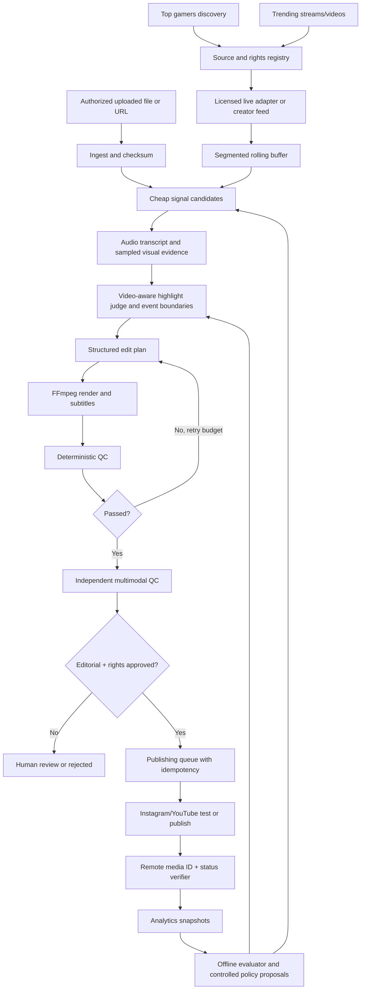

# System architecture and typed workflow contracts

## Architectural recommendation
**Modular monolith + separately scheduled media workers first**, with PostgreSQL for jobs/metrics, durable object or file storage, FFmpeg as renderer, pluggable models and publishers, single API/UI, deterministic validation and alert service. Do not deploy an LLM agent swarm merely to satisfy an “agent count.” Add a distributed queue when the 15-stream load benchmark proves the need. Keep PeakCut as one adapter candidate, not the immutable architecture.



## Component interfaces
| Component | Inputs | Outputs | Cannot do |
|---|---|---|---|
| Source registry | platform, creator, rights proof, feed type, OAuth ref | authorized `source_id` + entitlement | infer capture/repost rights from public URL |
| Ingest adapter | authorized stream/file; provider capability | timestamped segments, checksum, PTS map, source provenance | bypass bot checks, corrupt or overwrite source |
| Candidate engine | rolling signal window: audio RMS, transcript, chat *counts*, visual motion | `Candidate` list w/ detector features | submit raw hostile chat messages as instructions |
| Highlight judge | 30–120s contextual excerpt + evidence frames + ASR | bounded event interval, label and evidence | invent timestamps or assume hidden visual details |
| Edit planner | confirmed interval, platform crop map, style | validated EDL JSON | execute shell or download arbitrary URLs |
| Renderer | EDL, media source, FFmpeg templates | MP4 plus SRT/ASS, codec metadata | decide publishing rights |
| Machine QC | rendered MP4 and metadata | invariant report | replace human/editorial meaning judgment |
| Editorial QC | **final rendered clip** full video or sampled frames + audio + transcript | structured score, explanation, failure evidence | change raw media or declare account authorization |
| Supervisor | machine QC, editorial QC, rights, quota, human review | APPROVE/REVISE/HOLD/REJECT with reason | extend retry limit, waive rights, silently post |
| Publisher | approved clip, OAuth token, account quota | remote post ID, status log | retry uncertain posting without reconciliation |
| Feedback | post IDs, metric definitions/time series, clip feature log | measured lift with uncertainty; proposed config diff | silently deploy new prompts from 3 viral clips |

## Core data model
- `sources`: id, platform, canonical URL, title/creator id, region, discovered-via (top-gamers or trending), seen-at, allow-record?, allow-redistribute?, rights-evidence, expiry.
- `ingests`: id, source id, job run, file hash, rolling segment index, UTC->PTS alignment, duration, media probe JSON, storage path, authorization class.
- `candidates`: id, ingest id, start/end/peak PTS, audio/chat/visual features, original detector score, evidence timecodes, model version, language, label confidence.
- `clip_versions`: id, candidate id, version number, EDL hash, source start/end, output start/end, render hash, subtitle hash, model prompt version, ffmpeg version, qc reports.
- `approvals`: clip version, rights check, machine status, editorial status, human decision, approver, timestamp, rejection reason.
- `publish_attempts`: idempotency key `(platform, account_id, clip_hash, campaign_key)`, clip version, API request/response reference, remote ID, remote state, retry and error kind.
- `analytics_snapshots`: remote ID, metric name/value/unit, platform field mapping, observed_at UTC, freshness, scope, missing data marker.
- `experiment_assignments`: immutable variant, intervention, holdout label, randomization unit, allocation/stop rule.
- `resource_events`: worker CPU/RAM/disk/network/egress, GPU usage, queue wait, API tokens, billable cost, alerts.

## Minimal typed contracts (illustrative JSON, validate with Pydantic)
```json
{
  "candidate_id": "uuid",
  "source_id": "uuid",
  "evidence": [{"time_ms": 284000, "kind": "audio_rise", "measured_value": 0.71}],
  "start_ms": 276500,
  "peak_ms": 290200,
  "end_ms": 312000,
  "event_type": "unexpected_gameplay_event",
  "boundary_confidence": 0.82,
  "uncertainty_notes": ["Start may be 1.2s earlier"],
  "schema_version": "1.0"
}
```
```json
{
  "clip_id": "uuid",
  "source_timebase": "milliseconds",
  "edits": [
    {"op": "trim", "from_ms": 276500, "to_ms": 312000},
    {"op": "reframe", "from_ms": 276500, "to_ms": 312000, "layout": "gameplay_plus_facecam"},
    {"op": "caption", "text": "Exact transcribed text", "from_ms": 277000, "to_ms": 278100}
  ],
  "render": {"width": 1080, "height": 1920, "fps": 30, "format": "mp4"},
  "schema_version": "1.0"
}
```
**Validate before rendering:** `0 <= start < end <= decoded_media_duration`; timestamps within input and after timeline remap; PTS monotonic; all operation types allowlisted; finite numeric values; no intersecting contradictory crop plans; caption bounding boxes inside safe rectangle; final aspect ratio/codec supported.

## State machine
`DISCOVERED → AUTHORIZED → CAPTURING/INGESTED → CANDIDATES → SELECTED → EDIT_PLANNED → RENDERED → MACHINE_QC → EDITORIAL_QC → HUMAN_APPROVAL (until proven) → READY → PUBLISHING → REMOTE_CONFIRMED → ANALYTICS_ACTIVE → COMPLETE`

Side states: `HELD_RIGHTS`, `HELD_QUOTA`, `HELD_NO_SOURCES`, `WAITING_RESOURCES`, `REPAIR_1`, `REPAIR_2`, `REJECTED`, `FAILED_RETRYABLE`, `FAILED_TERMINAL`, `UNKNOWN_REMOTE_STATUS`, `DEAD_LETTER`. Only explicit code can transition; every transition includes an input/output pointer, actor, error class, attempt and UTC timestamp.

## Error isolation and timing
- Capture files written as `.part`; atomic rename after checksum/ffprobe; reconnect with discontinuity marker rather than joining corrupt PTS.
- Parallelism at per-source ingest and lightweight features; GPU/video ASR/expensive rendering through shared bounded queues. Prioritize near-live candidates over background uploaded batch jobs but avoid starving them.
- On timeout after submitting a post, **query remote status first** and reconcile the idempotency key. Do not blindly resubmit.
- Local volume pressure and API 429 should degrade intake or defer low-priority tasks; never delete the only approved rendered artifact or retry indefinitely.
- Delete raw source only when legal retention window, remote success and backup/approval rules permit. Preserve hashes, sparse metadata, evidence and audit records longer.

## Platform and hardware caveats
- Meta publishing requires supported account, permissions, HTTPS-accessible media and polling for actual publish status; do not assume provider claims imply account readiness.
- Official Twitch Clips API allows native clipping; compare end-to-end event length and rights. Longer-than-60-second clips may require a creator-authorized feed and custom buffer.
- Oracle Always Free (2026 docs): 1,500 OCPU-hours + 9,000 GB-hours/month for Ampere A1, equivalent to 2 OCPU and 12 GB always on (within availability); 15 concurrent transcoding or GPU inference **not established**. Test ARM64 model wheels and image support before any deployment.
- PeakCut's deployment guide suggests 8+ CPU, 16GB and 200GB disk for several users; this is a vendor recommendation, not measured 15-stream throughput.
